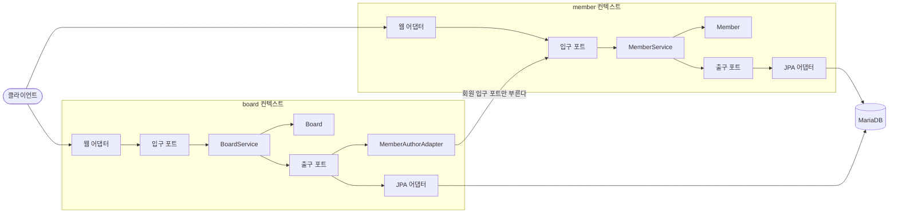

# hexagonal-board-api

회원과 게시글 API를 헥사고날 아키텍처로 만든 Spring Boot 프로젝트다. 예전 이름은 `architecture-tdd-ddd-poc`다.

이 저장소는 두 가지를 보여 주려고 만들었다.

1. 의존 방향을 지키는 설계. 도메인은 스프링과 JPA를 모르고, 그 규칙을 ArchUnit 테스트가 지킨다.
2. 브랜치와 PR 단위로 일하는 흐름. 버그는 실패하는 테스트를 먼저 커밋하고 그다음에 고쳤다.

설계 결정과 흐름도는 [설계 문서](docs/architecture.md)에 자세히 적었다.

## 기술 스택

| 구분 | 사용한 것 |
|---|---|
| 언어와 프레임워크 | Java 25, Spring Boot 4.1, Spring Security 7 |
| 데이터 | MariaDB 11.4, Spring Data JPA, OpenFeign QueryDSL 7, Flyway |
| 인증 | JWT (jjwt 0.13) |
| ID | ULID |
| 문서 | springdoc-openapi와 Swagger UI |
| 테스트 | JUnit 5, MockMvc, Testcontainers, ArchUnit |

## 한눈에 보는 구조



화살표는 "누가 누구를 아는지"를 뜻한다. 도메인(`Member`, `Board`)에서 나가는 화살표는 없다.

| 층 | 패키지 | 하는 일 |
|---|---|---|
| 도메인 | `domain` | 규칙을 지킨다. 순수 자바 클래스다 |
| 입구 포트 | `application.port.in` | 바깥이 부를 수 있는 유스케이스 목록이다 |
| 서비스 | `application.service` | 유스케이스를 처리한다. 저장소에서 꺼내 도메인에게 일을 시키고 다시 저장한다 |
| 출구 포트 | `application.port.out` | 서비스가 바깥(DB, 토큰, 다른 컨텍스트)에 바라는 것을 적은 인터페이스다 |
| 어댑터 | `adapter.in`, `adapter.out` | HTTP와 DB 같은 바깥 기술을 포트에 잇는다 |

## 의존 규칙은 테스트가 지킨다

`HexagonalArchitectureTest`가 아래 규칙을 검사한다. 어기면 빌드가 실패한다. 도메인에 `@Component`를 일부러 붙여서 실제로 실패하는 것도 확인했다.

- 도메인은 스프링, JPA, Swagger, Lombok을 모른다
- 도메인은 애플리케이션과 어댑터를 모른다
- 애플리케이션은 어댑터를 모른다
- 게시판의 웹 어댑터는 회원 컨텍스트를 모른다
- 게시판은 회원의 도메인과 저장소를 직접 쓰지 않는다

## 작업 흐름

이번 정리는 PR 다섯 개로 나눠 올렸다. 리팩터링 PR보다 버그 수정 PR을 먼저 올렸는데, 리팩터링은 동작을 바꾸지 않는 작업이라서 고친 동작을 테스트로 먼저 고정해 둬야 안전하기 때문이다.

| 순서 | 브랜치 | 내용 |
|---|---|---|
| 1 | `chore/upgrade-build` | Spring Boot 4.1, Java 25로 올렸다. DB 접속 정보를 환경변수로 옮겼다 |
| 2 | `fix/soft-delete-queries` | 지운 글과 탈퇴한 회원이 조회에 섞이던 버그, 내부 클래스 이름이 응답에 나가던 버그를 고쳤다 |
| 3 | `refactor/hexagonal-domain` | 규칙을 도메인으로 옮기고 의존 방향을 바로잡았다. API는 바꾸지 않았다 |
| 4 | `feat/jwt-auth` | 로그인과 JWT를 붙였다. 글쓴이를 요청 본문이 아니라 토큰으로 정한다 |
| 5 | `docs/readme` | 이 문서다 |

버그를 고칠 때는 커밋을 두 개로 나눴다. 먼저 `test:` 커밋에 버그를 재현하는 테스트가 실패하는 상태를 남기고, 다음 `fix:` 커밋에서 고쳐서 통과시켰다. 커밋 이력을 따라가면 무엇이 왜 실패했는지 볼 수 있다.

## 고친 버그

| 버그 | 원인 | 막는 테스트 |
|---|---|---|
| 지운 글이 단건 조회에서 200으로 나온다 | 단건 조회가 삭제 여부를 보지 않았다 | `SoftDeleteAndSearchRegressionTest` |
| 목록 전체 개수에 지운 글과 탈퇴한 회원이 들어간다 | 개수 쿼리에만 삭제 조건이 빠졌다 | `SoftDeleteAndSearchRegressionTest` |
| 성별을 소문자로 검색하면 500 오류가 난다 | 검사는 대소문자를 무시했는데 변환은 무시하지 않았다 | `SoftDeleteAndSearchRegressionTest` |
| 이미 가입된 이메일로 다시 가입된다 | 중복 확인이 없었다 | `SoftDeleteAndSearchRegressionTest` |
| 없는 회원으로 글을 쓰면 응답에 JPA 엔티티의 클래스 이름과 패키지가 나간다 | `getReferenceById`가 던진 예외 메시지를 그대로 응답했다 | `ErrorMessageLeakRegressionTest` |
| 다른 회원의 ID를 넣으면 그 회원 이름으로 글을 쓸 수 있다 | 요청 본문의 `memberId`를 믿었다 | `BoardRestControllerTest` |
| 다른 회원이 글을 지울 수 있다 | 삭제할 때 글쓴이를 확인하지 않았다 | `BoardRestControllerTest` |
| 글 5개 목록에 쿼리가 7번 나간다 | 글마다 글쓴이를 따로 조회했다 | `BoardAuthorRegressionTest` |
| 글 응답에 글쓴이의 이메일, 전화번호, 주소가 담긴다 | 회원 응답 DTO를 그대로 넣었다 | `BoardAuthorRegressionTest` |
| 글쓴이가 탈퇴하면 그 글도 404가 된다 | 글쓴이를 찾지 못하면 예외를 던졌다 | `BoardAuthorRegressionTest` |

## 테스트

```bash
./gradlew test
```

Docker가 켜져 있어야 한다. 테스트는 모두 55개다.

| 종류 | 예시 | 확인하는 것 |
|---|---|---|
| 도메인 단위 테스트 | `MemberTest`, `BoardTest` | 탈퇴, 글쓴이 확인 같은 규칙. 스프링 없이 돈다 |
| 서비스 테스트 | `MemberServiceTest`, `BoardServiceTest` | 유스케이스 흐름. 포트를 메모리로 구현한 가짜를 써서, 포트를 불렀는지가 아니라 결과가 맞는지 본다 |
| 영속성 어댑터 테스트 | `MemberPersistenceAdapterTest` | MariaDB 컨테이너에서 실제 쿼리를 돌린다 |
| API 테스트 | `BoardRestControllerTest`, `regression` 패키지 | 경로, 상태 코드, JSON 모양 |
| 아키텍처 테스트 | `HexagonalArchitectureTest` | 의존 방향 |

## 실행

Java 25와 Docker가 필요하다.

```bash
cp .env.example .env     # 빈칸(DB_PASSWORD, DB_ROOT_PASSWORD, JWT_SECRET)을 채운다
docker compose up -d     # MariaDB
./gradlew bootRun
```

local 프로필에서는 더미 회원 20만 건(`db/dummy`)을 함께 넣어서 처음 실행할 때 시간이 조금 걸린다. 테스트에서는 넣지 않는다.

Swagger UI는 http://localhost:8099/swagger-ui.html 에 있다.

## API

목록의 `page`는 1부터 센다. 오류는 `{"code": "...", "message": "..."}` 모양으로 응답한다.

| 메서드 | 경로 | 누가 | 설명 |
|---|---|---|---|
| POST | `/v1/members` | 누구나 | 회원가입 |
| POST | `/v1/auth/login` | 누구나 | 로그인. 액세스 토큰을 준다 |
| GET, PATCH, DELETE | `/v1/members/me` | 로그인한 회원 | 내 정보 보기, 연락처 고치기, 탈퇴 |
| GET | `/v1/admin/members` | 관리자 | 회원 검색(이메일, 이름, 성별), 페이징, 정렬 |
| GET | `/v1/admin/members/{memberId}` | 관리자 | 회원 한 명 보기 |
| GET | `/v1/boards`, `/v1/boards/{boardId}` | 누구나 | 게시글 목록, 한 개 보기 |
| POST | `/v1/boards` | 로그인한 회원 | 게시글 쓰기 |
| PATCH, DELETE | `/v1/boards/{boardId}` | 글쓴이 | 게시글 고치기, 지우기 |

## 아직 남은 것

- 리프레시 토큰이 없어서 30분마다 다시 로그인해야 한다.
- 탈퇴해도 이미 받은 액세스 토큰은 만료될 때까지 거절되지 않는다. 글쓰기는 탈퇴 확인에서 막힌다.
- 관리자 계정은 API로 만들 수 없고 DB에서 `role`을 바꿔야 한다.
- `board.member_id`의 외래 키는 그대로 두었다. 코드는 회원을 ID로만 가리키지만, 두 컨텍스트가 같은 DB를 쓰는 동안은 DB에서도 무결성을 지키는 편이 낫다고 보았다.
