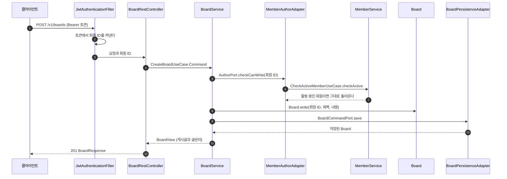
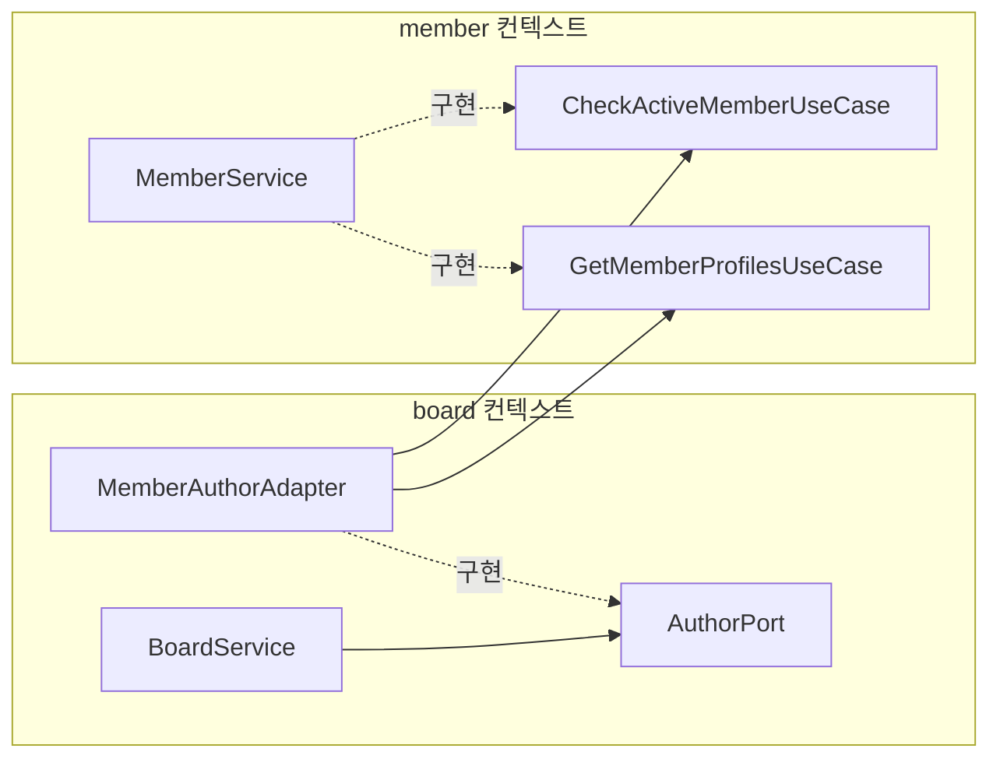
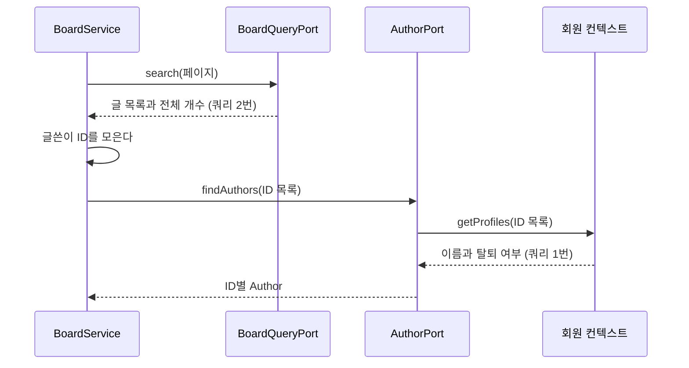
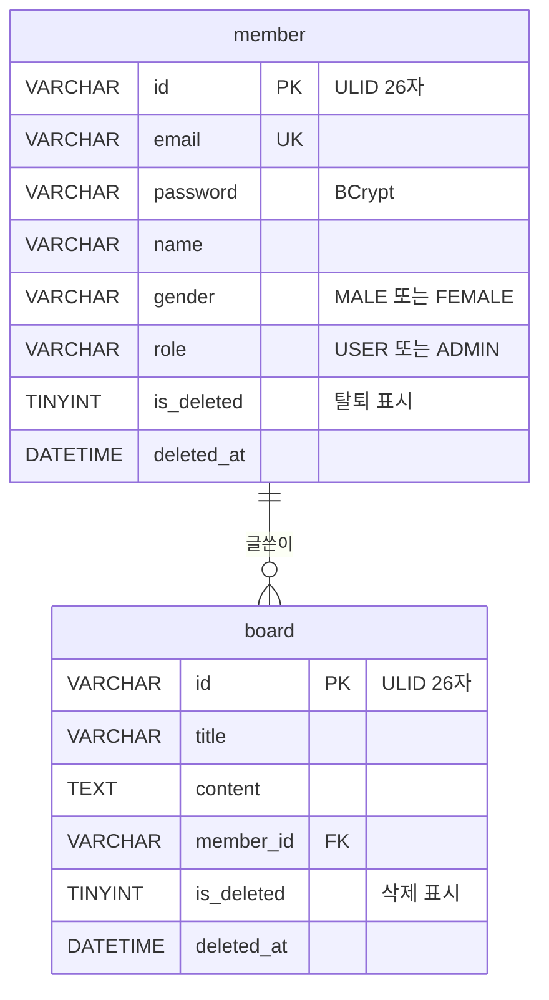

# 설계 문서

README에서 짧게 적은 구조와 설계 결정을 그림과 함께 자세히 적는다. 코드가 바뀌면 같은 PR에서 이 문서도 고친다.

## 글 하나를 쓸 때 일어나는 일

요청이 어댑터와 포트를 거쳐 도메인까지 갔다가 돌아오는 순서다.

- 글쓴이는 요청 본문이 아니라 토큰에서 정한다(2번).
- 게시판은 회원 저장소를 보지 않고 회원 컨텍스트의 입구 포트만 부른다(5번, 6번).
- 서비스는 JPA를 모른다. 저장은 출구 포트(`BoardCommandPort`)에 맡긴다(9번).

## 두 컨텍스트가 만나는 곳

게시판은 글쓴이에 대해 두 가지만 알면 된다. 이 회원이 글을 쓸 수 있는지, 그리고 이 회원의 이름이 무엇인지다. 그래서 게시판 쪽에 `AuthorPort`를 두고, 회원 쪽 입구 포트에 잇는 어댑터(`MemberAuthorAdapter`)는 하나만 둔다.

게시판이 보는 글쓴이는 `Author(id, name)` 값 하나다. 회원의 이메일이나 전화번호는 게시판까지 오지 않는다.

## 글 목록에서 N+1을 없앤 방법

예전에는 글 목록을 만든 뒤 글마다 회원을 한 번씩 조회했다. 글 5개를 보면 쿼리가 7번 나갔다.

지금은 글 수와 상관없이 쿼리가 3번 나간다. `BoardAuthorRegressionTest`가 Hibernate 통계로 이 숫자를 센다.

board 테이블과 member 테이블을 조인하면 쿼리는 2번으로 줄일 수 있다. 하지만 그러려면 게시판 어댑터가 회원의 JPA 엔티티를 알아야 하고, 컨텍스트 경계가 깨진다. 쿼리 한 번을 더 쓰고 경계를 지키는 쪽을 골랐다.

## 테이블

스키마는 Flyway가 `src/main/resources/db/migration`의 SQL로 만든다. JPA는 스키마를 만들지 않는다(`ddl-auto: none`).

회원과 글은 지우지 않고 `is_deleted`만 바꾼다(소프트 삭제). 그래서 조회 쿼리마다 삭제 조건을 넣어야 하는데, 예전 코드는 개수 쿼리에서 이 조건을 빠뜨렸다.

## 설계하면서 정한 것

### 도메인 모델과 JPA 엔티티를 나눴다

`Member`와 `MemberJpaEntity`는 다른 클래스다. 도메인은 규칙만, 엔티티는 테이블 모양만 책임진다. 그래서 테이블 칸 이름이 바뀌어도 도메인 코드는 그대로다.

대신 둘 사이를 오가는 변환 코드(`from`, `apply`, `toDomain`)가 생긴다. 예전에는 이 변환을 MapStruct로 했는데, 매퍼 대부분이 손으로 쓴 `default` 메서드여서 도구를 쓰는 이점이 적었다. 지금은 엔티티 안의 짧은 메서드로 대신한다.

### ID는 도메인이 만든다

`Member.register`와 `Board.write`가 ULID로 ID를 만든다. 저장하기 전에도 ID가 있어서 도메인 테스트가 DB 없이 돈다.

ID가 미리 있으면 Spring Data의 `save`가 새 엔티티인지 헷갈려서 SELECT를 한 번 더 한다. 엔티티가 `Persistable`을 구현하고 생성 시각이 없으면 새것으로 보게 해서 이 문제를 막았다.

### 오류 코드는 HTTP를 모른다

`MemberErrorCode`, `BoardErrorCode`는 코드와 메시지, 그리고 `ErrorType`(`NOT_FOUND`, `FORBIDDEN` 같은 종류)만 갖는다. HTTP 상태 코드로 바꾸는 일은 웹 어댑터의 `GlobalExceptionHandler`가 한다. 그래서 도메인이 스프링의 `HttpStatus`를 import하지 않아도 된다.

### 서비스 테스트는 mock 대신 메모리 가짜를 쓴다

예전 서비스 테스트는 mock으로 "포트의 save를 불렀는가"를 확인했다. 이런 테스트는 구현을 바꾸면 깨지고, 결과가 틀려도 통과할 수 있다.

지금은 출구 포트를 메모리 `Map`으로 구현한 가짜(`InMemoryMemberStore`)를 넣고, 유스케이스를 실행한 뒤 결과를 확인한다. 헥사고날 구조에서는 출구 포트가 인터페이스라서 가짜를 만들기 쉽다.

### 현재 시각은 Clock으로 받는다

탈퇴 시각과 삭제 시각은 `LocalDateTime.now(clock)`으로 정한다. 테스트에서는 고정한 `Clock`을 넣어서 시각까지 정확히 확인한다.

### 읽기 포트와 쓰기 포트를 나눴다

출구 포트를 `MemberQueryPort`와 `MemberCommandPort`로 나눴다. 읽기 전용 DB나 캐시를 붙일 때 읽기 쪽 구현만 바꿀 수 있다. 다만 읽기 모델을 따로 두는 본격적인 CQRS는 아니고, 지금은 같은 테이블을 같은 어댑터가 읽고 쓴다.

### 애플리케이션 층이 Spring Data의 Pageable을 쓴다

유스케이스가 `Pageable`과 `Page`를 주고받는다. 엄격하게 하면 페이지 정보도 직접 만든 타입으로 바꿔야 하지만, 그만큼 변환 코드가 늘어난다. 이 정도의 스프링 의존은 받아들였고, ArchUnit 규칙도 도메인에만 스프링을 막는다.
